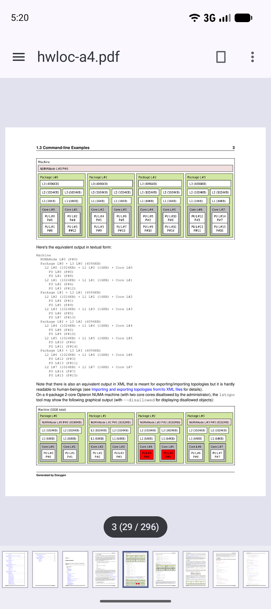

<p align="center">
  
</p>

<h1 align="center">Specto</h1>

<p align="center">
  A fast document viewer and light editor for Linux and Android, written in Rust.
</p>

<p align="center">
  <a href="apps/desktop/README.md">Desktop</a> ·
  <a href="apps/android/README.md">Android</a> ·
  <a href="docs/ARCHITECTURE.md">Architecture</a> ·
  <a href="docs/TASKS.md">Plan</a>
</p>

<p align="center">
  
  &nbsp;
  
</p>

Specto is a shared core with two apps on top of it:

- [Desktop](apps/desktop/README.md): GTK 4 and libadwaita, for Linux (also runs on macOS)
- [Android](apps/android/README.md): Kotlin and Jetpack Compose

## Why?

I enjoy working with Preview on macOS. When I want to read a PDF, or do some
light editing (reorder or delete pages, highlight something, fill in a form),
it's what I reach for: it's fast, it stays out of the way, and it does the
common things well. On Linux I haven't found anything equivalent, so this is my
attempt at one.

I also miss a decent open-source PDF viewer for Android that is pleasant to
use. Since the hard parts (rendering, layout, zooming, text) are the same
everywhere, they live in a shared Rust core, and each app is a thin native
layer on top of it.

## Goals

Rough feature parity with Preview, not Adobe Acrobat:

- **Viewing**: sharp rendering on HiDPI screens, zoom, single page, continuous
  and two pages side by side, thumbnails, table of contents, search, text
  selection
- **Page editing**: delete, reorder and rotate pages, insert pages from another
  PDF, merge documents
- **Markup**: highlight, underline and strike through text, freehand drawing,
  shapes, text boxes, sticky notes
- **Forms**: fill in form fields (text, checkboxes, radio buttons, dropdowns
  and lists) and save the filled values
- **Censor**: remove information from documents safely

Not planned, at least for now: editing existing page content (reflowing text),
XFA forms, creating digital signatures, JavaScript, OCR, PDF/A conversion.

## Status

Both apps are usable as PDF viewers. They render pages sharply at any zoom and
on HiDPI screens, and stay responsive on huge documents. They have the usual
layouts, thumbnails, the table of contents, links and printed page numbers,
open encrypted files, and remember where you were in each document. In both you
can select, copy and search text, print, and edit pages by rotating, deleting
and reordering them.

The desktop app can also insert pages from other PDFs and export a selection of
pages. It has markup too: highlighting, underlining and striking through text,
freehand drawing, shapes, text boxes and notes. Forms are still to come.

The detailed plan is in [docs/TASKS.md](docs/TASKS.md).

## Building

Each app has its own instructions, with what to install first:

- [apps/desktop/BUILDING.md](apps/desktop/BUILDING.md): Fedora and macOS, and
  the Flatpak
- [apps/android/BUILDING.md](apps/android/BUILDING.md): phones and emulators

The shared crates and the tools need only Rust 1.92 or newer:

```sh
cargo build --release
cargo test --workspace
```

The tests check saved files with qpdf where it is installed. The specto
command-line tool, for development, is described in
[tools/README.md](tools/README.md).

## Layout

- [`crates/`](crates/README.md): the shared Rust core, which does the
  rendering, page layout, text, editing and saving
- [`apps/desktop`](apps/desktop/README.md): the desktop app, in Rust with GTK 4
  and libadwaita
- [`apps/android`](apps/android/README.md): the Android app, in Kotlin with
  Jetpack Compose
- [`tools/`](tools/README.md): development tools, such as the specto
  command-line tool
- [`packaging/`](packaging/README.md): installable packages of the desktop app
  (Flatpak)
- [`corpus/`](corpus/README.md): fetches the test corpus
- `spikes/`: early prototypes
- `docs/`: see below

## Documentation

- [crates/README.md](crates/README.md): what each crate does, and how they
  depend on each other
- [docs/ARCHITECTURE.md](docs/ARCHITECTURE.md): data model, rendering
  pipeline, how the apps plug in
- [docs/DECISIONS.md](docs/DECISIONS.md): technology choices, the alternatives
  considered, and open questions
- [docs/TASKS.md](docs/TASKS.md): the task list, by milestone
- [apps/desktop/FEATURES.md](apps/desktop/FEATURES.md) and
  [apps/android/FEATURES.md](apps/android/FEATURES.md): what each app does
- [apps/desktop/TESTING.md](apps/desktop/TESTING.md) and
  [apps/android/TESTING.md](apps/android/TESTING.md): testing each app, by hand
  and automated
- [corpus/README.md](corpus/README.md): the test corpus and regression runs

## Similar projects

- [Censor](https://codeberg.org/censor/Censor)
- [GNOME Papers/Document Viewer](https://apps.gnome.org/Papers/)
- [Evince](https://gitlab.gnome.org/GNOME/evince)
- [Apple Preview](https://en.wikipedia.org/wiki/Preview_(Apple))

## License

Licensed under either of [Apache License, Version 2.0](LICENSE-APACHE) or [MIT
license](LICENSE-MIT), at your option.
