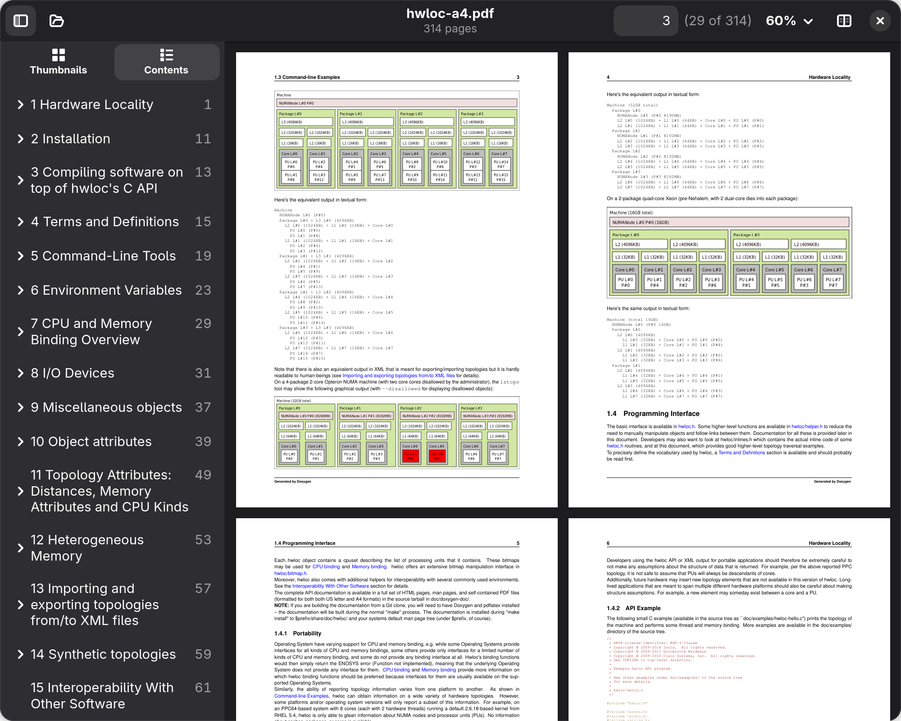

# pdfrs

A PDF viewer and light editor written in Rust, with a shared core and two apps:

- [Desktop](apps/desktop/README.md): GTK 4 and libadwaita, for Linux (also runs on macOS)
- [Android](apps/android/README.md): Kotlin and Jetpack Compose



## Why?

I enjoy working with Preview on macOS. When I want to read a PDF, or do some light editing (reorder or delete pages, highlight something, fill in a form), it's what I reach for: it's fast, it stays out of the way, and it does the common things well. On Linux I haven't found anything equivalent, so this is my attempt at one.

I also miss a decent open-source PDF viewer for Android that is pleasant to use. Since the hard parts (rendering, layout, zooming, text) are the same everywhere, they live in a shared Rust core, and each app is a thin native layer on top of it.

## Goals

Rough feature parity with Preview, not Adobe Acrobat:

| Area | Scope |
|---|---|
| Viewing | HiDPI-sharp rendering, zoom, single page / continuous / two pages side by side, thumbnails, table of contents, search, text selection |
| Page editing | Delete, reorder, rotate, insert pages from another PDF, merge documents |
| Markup | Highlight / underline / strike-through, freehand ink, shapes, text boxes, sticky notes |
| Forms | Fill in form fields (text, checkbox, radio, dropdown/list), save the filled values |

Not planned, at least for now: editing existing page content (reflowing text), XFA forms, creating digital signatures, JavaScript, OCR, PDF/A conversion.

## Status

Both apps are usable as PDF viewers. They render pages sharply at any zoom and on HiDPI screens, and stay responsive on huge documents. They have the usual layouts, thumbnails, the table of contents, links and printed page numbers, open encrypted files, and remember where you were in each document. Text selection and search are being worked on now. Editing (pages, annotations, forms) and saving come after that. The detailed plan is in [docs/TASKS.md](docs/TASKS.md).

## Building

```sh
cargo build --release
target/release/pdfrs-gtk file.pdf                         # the desktop app
target/release/pdfrs info file.pdf                        # the command-line dev tool
target/release/pdfrs render file.pdf -o out -s 2          # pages → PNG
target/release/pdfrs text file.pdf -p 1                   # the text layer
target/release/pdfrs corpus corpus/files/... --reference  # regression run, see corpus/README.md
```

The desktop app needs the GTK 4 and libadwaita development packages; see [apps/desktop/README.md](apps/desktop/README.md). For Android, see [apps/android/README.md](apps/android/README.md).

## Layout

- `crates/pdfrs-geom`: typed coordinate spaces and page geometry (crop box, rotation)
- `crates/pdfrs-source`: opening, metadata, outline, links and page labels
- `crates/pdfrs-text`: text layer (characters with positions, words, lines)
- `crates/pdfrs-render`: `Document` trait + hayro backend, tile grid and cache, background render scheduler
- `crates/pdfrs-view`: UI-agnostic viewer core (layout modes, zoom, scrolling, tile planning)
- `crates/pdfrs-ffi`: bindings for Android (UniFFI, plus JNI for the per-frame path)
- `apps/desktop`: GTK 4 + libadwaita app (`pdfrs-gtk`)
- `apps/android`: Android app (Kotlin + Compose)
- `tools/pdfrs-cli`: the `pdfrs` dev tool
- `tools/headless`: run the desktop app under a headless compositor; `check.py` is the automated end-to-end check (also in CI), `smoke.sh` takes screenshots
- `spikes/`: early prototypes, kept for the measurements in docs/M0-FINDINGS.md: `lopdf-spike` (editing and saving), `gtk-canvas` (tiled GTK viewer with a benchmark and probe mode), `text-check` (text extraction against `pdftotext`)
- `corpus/`: test corpus fetch script (the files are git-ignored)

## Documentation

- [docs/ARCHITECTURE.md](docs/ARCHITECTURE.md): crate layout, data model, rendering pipeline, how the apps plug in
- [docs/DECISIONS.md](docs/DECISIONS.md): technology choices, the alternatives considered, and open questions
- [docs/TASKS.md](docs/TASKS.md): the task list, by milestone
- [docs/M0-FINDINGS.md](docs/M0-FINDINGS.md): measurements from the prototypes and since (rendering, HiDPI, text, Android)
- [apps/desktop/FEATURES.md](apps/desktop/FEATURES.md) and [apps/android/FEATURES.md](apps/android/FEATURES.md): what each app does
- [apps/desktop/TESTING.md](apps/desktop/TESTING.md): testing the desktop app, by hand and automated
- [corpus/README.md](corpus/README.md): the test corpus and regression runs

## Similar projects

- [Censor](https://codeberg.org/censor/Censor)
- [GNOME Papers/Document Viewer](https://apps.gnome.org/Papers/)
- [Evince](https://gitlab.gnome.org/GNOME/evince)
- [Apple Preview](https://en.wikipedia.org/wiki/Preview_(Apple))

## License

Licensed under either of [Apache License, Version 2.0](LICENSE-APACHE) or [MIT license](LICENSE-MIT), at your option.
