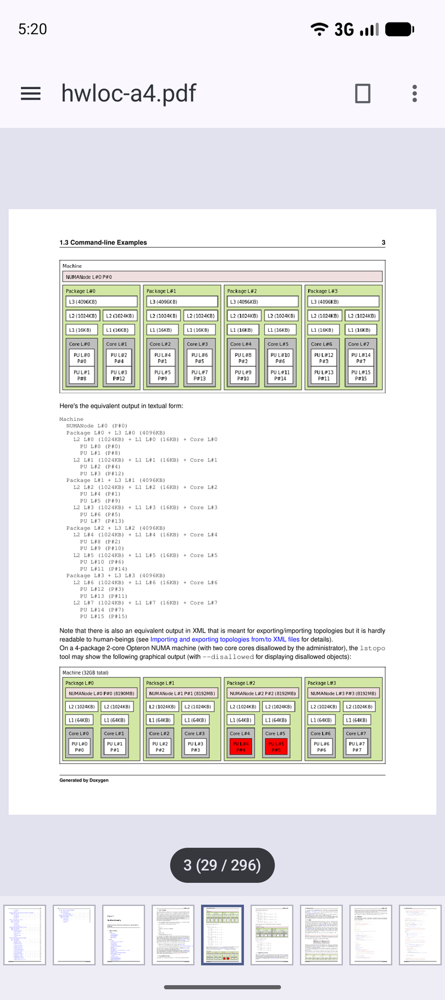
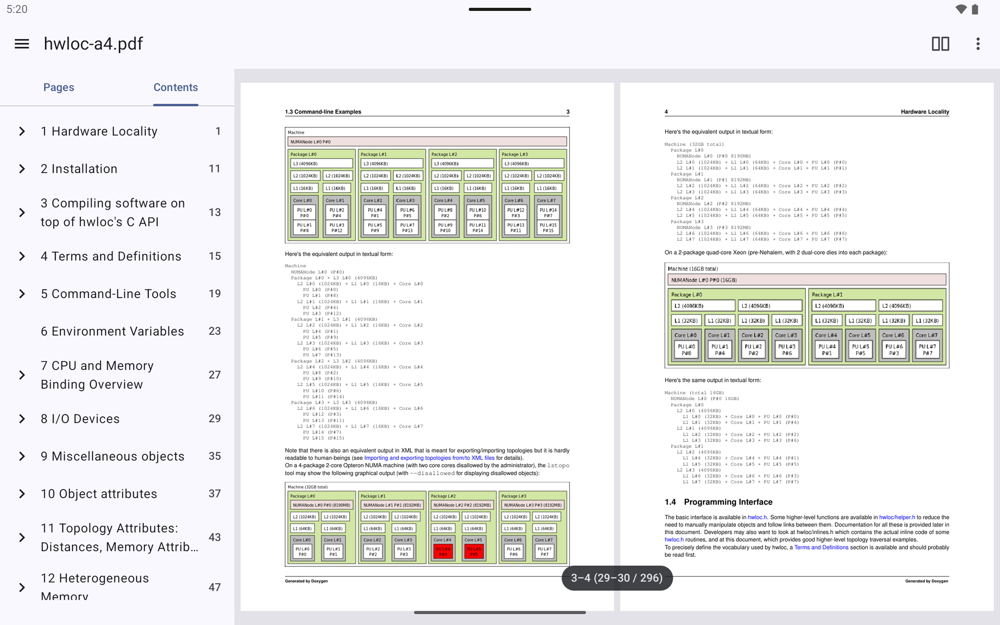

# Specto for Android

A fast, pleasant PDF reader for Android phones and tablets. Built with Rust and Jetpack Compose, it shares its core with the desktop app.

<p align="center">
  
  &nbsp;
  
</p>

Android has few open-source PDF viewers, and the ones there are tend to feel clunky: slow to render, blurry while zooming, or awkward to navigate. Specto aims to be a reader that is simply nice to use, with smooth page turns, sharp pages at any zoom, and quick ways to find your way around a long document. Light editing, such as annotations and filling in forms, will follow.

## Features

What it can do today:

- Paged reading with swipes, each page fitted to the screen, or continuous scrolling
- Pinch and double-tap zoom, with pages sharp at any zoom
- A thumbnail strip, a grid of all pages, the table of contents, links, and printed page numbers ("iii (3 / 240)")
- Search, with all matches highlighted
- Selecting text, and copying or sharing it
- Editing pages: rotating, deleting and reordering them, with undo, and saving the result
- Two pages side by side on tablets and other wide windows, optionally with the cover page on its own
- Fit page or fit width, full screen, keyboard navigation, light and dark mode
- Password-protected PDFs
- Recent documents, and continuing where you left off
- Printing, sharing the open document with other apps, and its properties (title, author, page size, …)
- Optional: keep the screen on while reading, turn pages with the volume keys

Coming next: inserting pages from other documents, annotations, and filling in forms.

The full list of features, with how to check each one, is in [FEATURES.md](FEATURES.md).

## Implementation

The core is implemented in Rust and shared with the desktop app. The Android app is a Kotlin and Compose layer over these shared crates:

- `specto-view`: page layout, zoom, scrolling, and which parts of which pages to render
- `specto-render`: rendering pages into tiles in the background, with [hayro](https://github.com/LaurenzV/hayro), a PDF renderer written in Rust
- `specto-source`: reading the table of contents, links and page labels

They're compiled into `libspecto_ffi.so`. The crate `specto-ffi` exposes them to Kotlin through UniFFI, plus a few hand-written JNI functions for the work done on every frame, where UniFFI's overhead was too high. The app itself draws the rendered tiles and handles gestures, the file picker and recent documents. More detail is in [docs/ARCHITECTURE.md](../../docs/ARCHITECTURE.md).

## Building

```sh
cd apps/android
./gradlew :app:installDebug      # build and install on a connected device or emulator
```

What to install first, release builds and their signing key, and emulators on Intel machines are in [BUILDING.md](BUILDING.md). The app runs on Android 8.0 (API 26) and newer.

## Testing

```sh
cd apps/android
./gradlew :app:testDebugUnitTest                                       # unit tests
ANDROID_SERIAL=emulator-5554 ./gradlew :app:connectedDebugAndroidTest  # UI tests on an emulator
```

The UI tests (`ReaderTest`, `DocumentTest`) cover most of [FEATURES.md](FEATURES.md) on phone-sized and tablet-sized screens: turning pages by swipe and key, the strip, the page grid, the table of contents, links, printed page numbers, full screen, the sidebar and two pages on wide windows, rotation, passwords, and what is remembered; further classes cover search, text selection, page edits and saving, sharing, printing and the settings. The serial matters when a phone is plugged in as well: a test run installs and then removes the app on its target.

CI builds the app (the release build too, so that code shrinking is known to go through) and runs the unit tests on every change, and the UI tests on an emulator for pushes to `main`. What tests can't judge (how it looks and feels, the file picker, pinch zoom) is checked by hand with [FEATURES.md](FEATURES.md).

## Project structure

In `app/src/main/kotlin/net/xfbs/specto/`:

- `MainActivity.kt`: the activity, theme, top bar, menus and dialogs
- `StartScreen.kt`: the start screen with recent documents
- `PdfView.kt`, `PdfViewState.kt`: the page view, its gestures, keys and state
- `ViewFrame.kt`: one frame of the view as planned in Rust, decoded from the JNI call
- `Native.kt`: the JNI functions (the rest of the Rust API comes through UniFFI's generated bindings)
- `ThumbnailStrip.kt`, `PagesGrid.kt`, `OutlineList.kt`: the strip, the page grid and the table of contents
- `DocumentStore.kt`: recent documents and where each was left off
- `Share.kt`, `Print.kt`: handing the document to the share sheet and to the print dialog
- `CrashLog.kt`, `SpectoApp.kt`: the log of crashes that Settings shows, set up as the app starts

Elsewhere:

- `app/src/main/res/values/strings.xml`: everything the app says; a translation is a copy of it in `values-<language>`
- `app/proguard-rules.pro`: what code shrinking must leave alone in a release build
- `app/src/test/`: unit tests
- `app/src/androidTest/`: UI tests, with their test PDFs in `assets/` (written by `make-fixtures.py`)
- `app/build.gradle.kts`: the build, including cross-compiling the Rust library
- `FEATURES.md`: the feature list, as things to check by hand
- `screenshot-phone.png`, `screenshot-tablet.png`: the screenshots above, taken on the emulators with hwloc's manual (BSD licence), the document the desktop app's screenshot shows too
