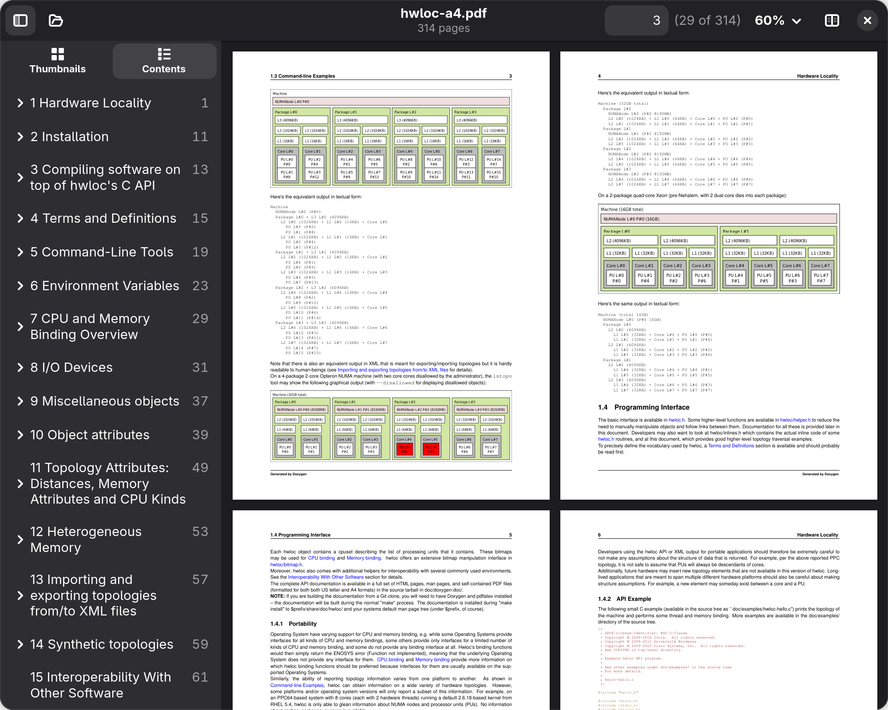

# Specto for the desktop

A fast, responsive PDF viewer with light editing capabilities. Built with Rust and GTK 4, designed to fit in well on Linux with the GNOME desktop, but it also runs on macOS.

<p align="center">
  
</p>

There are several PDF readers for Linux, but few support basic editing, such as merging PDFs, rotating pages, adding annotations or filling in forms. The editors that do support these are often not pleasant to use. Specto is meant to fill that gap: not a full-fledged PDF editor, but enough to do the common things quickly.

## Features

What it can do today:

- Sharp rendering at any zoom, including on HiDPI and fractionally scaled screens
- Single page, continuous and two-page layouts, optionally with the cover page on its own
- Fit width, fit page and free zoom, with touchpad pinch and Ctrl+scroll
- Thumbnails, the table of contents, links, and printed page numbers ("iv", "A-3")
- Selecting and copying text: drag, double-click a word, triple-click a line, select all
- Searching, ignoring case and accents, with all matches highlighted
- Rotating pages, with undo and redo, and saving the result
- Password-protected PDFs
- Recent files, and remembering where you were in each file
- Staying responsive on huge or very complex pages

Coming next, more editing: reordering and deleting pages, merging documents, annotations (highlights, notes, drawings) and filling in forms.

The full list of features is in [FEATURES.md](FEATURES.md).

## Implementation

The core is implemented in Rust and shared with the Android app. The GTK app is a thin layer over these shared crates:

- `specto-session`: an open document: its files, the pages as edited, the text selection and the search, and saving
- `specto-view`: page layout, zoom, scrolling, which parts of which pages to render, text selection, and search results
- `specto-render`: rendering pages into tiles in the background, with [hayro](https://github.com/LaurenzV/hayro), a PDF renderer written in Rust
- `specto-source`: reading the table of contents, links and page labels
- `specto-text`: the text on each page, for selection and search
- `specto-doc`: the pages of a document being edited and what was done to its annotations, with undo and redo
- `specto-annot`: annotations (highlights and other markup): the model, reading the ones a file has, and how they look
- `specto-write`: saving, by writing the edited pages as a new PDF

The app itself draws the rendered tiles, handles input, and provides the windows, menus and sidebar with GTK 4 and libadwaita. More detail is in [docs/ARCHITECTURE.md](../../docs/ARCHITECTURE.md).

## Building

```sh
cargo build --release -p specto-desktop
target/release/specto-gtk file.pdf
```

What to install first on Fedora and macOS, and the Flatpak, are in [BUILDING.md](BUILDING.md).

## Testing

- Automated: `tools/headless/check.py` runs the app in a headless compositor and checks opening, navigation, layouts, zoom, saved state and more, at several screen scales. It runs in CI.
- By hand: [TESTING.md](TESTING.md) has the setup, test files and the checks that need a person, on Linux and macOS.

## Project structure

- `src/main.rs`: application, shortcuts, the About dialog, the macOS menu bar
- `src/window.rs`: a document window: header bar, start page, actions, opening files
- `src/canvas.rs`: the page view, a `GtkScrollable` widget that draws `specto-view` frames
- `src/document.rs`: an open document: the shared session plus what belongs to GTK (tile cache of textures, render client)
- `src/thumbnails.rs`, `src/outline.rs`: the two sidebar tabs
- `src/state.rs`: saved view state per file
- `src/i18n.rs`: translations through gettext; `po/specto.pot` is the template of its strings, written by `po/update-pot.sh`
- `src/debug.rs`: test hooks, only enabled with `SPECTO_DEBUG=1`
- `FEATURES.md`, `TESTING.md`: the feature list and how to test it
- `screenshot.png`: the screenshot above, made by `tools/headless/readme-screenshot.sh`
